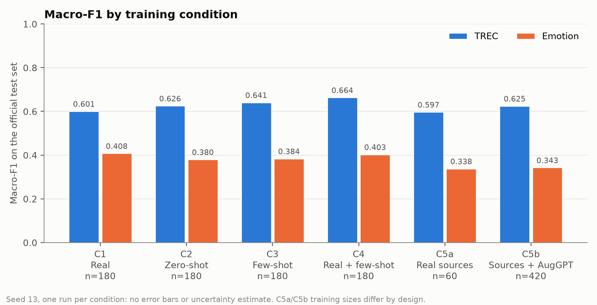
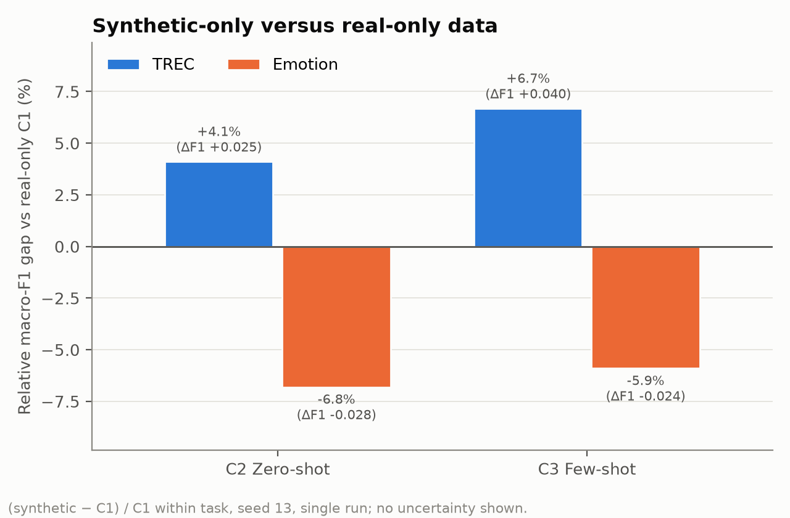

# SynthText: synthetic training data for text classification

[](https://github.com/kausthubabelagodbdes24-oss/LLM-synthetic-data-classifiers/actions/workflows/ci.yml)


This project studies whether a compact local language model can generate useful training data for text classification. It compares real, synthetic, mixed, and paraphrase-augmented training sets on two six-class tasks:

- **TREC question classification**, treated as the more objective task.
- **Emotion classification**, treated as the more subjective task.

The completed study is an exploratory, single-seed comparison. It reports observed results without claiming statistical significance, stability, or that subjectivity caused the difference between tasks.

## Start here

For a concise review of the finished project:

1. Read the [final report](docs/REPORT.pdf) or its [Markdown source](docs/REPORT.md).
2. Open the [Google Colab walkthrough](https://colab.research.google.com/github/kausthubabelagodbdes24-oss/LLM-synthetic-data-classifiers/blob/main/notebooks/SynthText_scope30_walkthrough.ipynb) to see the pipeline and the accepted results.
3. See the [analysis summary](docs/analysis/scope30-v1-seed13/summary.md) and the [written interpretation](docs/analysis/scope30-v1-seed13-interpretation.md).
4. Use the [documentation index](docs/README.md) for methods, provenance, and technical reproduction.

## Research design

The experiment uses seed 13 and six conditions for each task:

| Condition | Training data | Rows per task |
| --- | --- | ---: |
| C1 | Real data only | 180 |
| C2 | Zero-shot synthetic data | 180 |
| C3 | Few-shot synthetic data | 180 |
| C4 | Half real, half few-shot synthetic | 180 |
| C5a | Ten real source examples per label | 60 |
| C5b | The same real sources plus six AugGPT paraphrases per source | 420 |

Synthetic text was generated locally with `qwen3:4b`. Classification used frozen `sentence-transformers/all-MiniLM-L6-v2` embeddings and logistic regression. Every condition was evaluated on the unchanged official test set for its task using macro-F1 and accuracy.

The exact final specification is in [docs/PROJECT_SPEC.md](docs/PROJECT_SPEC.md).

## Results

| Task | Metric | C1 Real | C2 Zero-shot | C3 Few-shot | C4 Mixed | C5a Sources | C5b AugGPT |
| --- | --- | ---: | ---: | ---: | ---: | ---: | ---: |
| TREC | Macro-F1 | 0.6009 | 0.6257 | 0.6411 | **0.6638** | 0.5974 | 0.6251 |
| TREC | Accuracy | 0.6520 | 0.6680 | 0.6880 | **0.7100** | 0.6400 | 0.6700 |
| Emotion | Macro-F1 | **0.4082** | 0.3804 | 0.3841 | 0.4033 | 0.3381 | 0.3432 |
| Emotion | Accuracy | 0.4420 | 0.4305 | 0.4285 | **0.4425** | 0.3730 | 0.3705 |

In this run, synthetic-only training scored above real-only training on TREC and below it on Emotion. Few-shot synthetic data had a higher macro-F1 than zero-shot synthetic data on both tasks. The mixed condition had the highest TREC score, while its Emotion macro-F1 remained slightly below real-only training. C5b had a higher macro-F1 than C5a on both tasks, but that comparison also used 420 training rows instead of 60.





These are single-run observations. The report discusses the small data size, task confounding, unequal C5 training sizes, generation costs, retained quality flags, and one disclosed TREC train/test duplicate.

## Project outputs

| Output | Location |
| --- | --- |
| Reviewed report | [docs/REPORT.pdf](docs/REPORT.pdf) |
| Colab walkthrough | [notebooks/SynthText_scope30_walkthrough.ipynb](notebooks/SynthText_scope30_walkthrough.ipynb) |
| Machine-readable analysis | [docs/analysis/scope30-v1-seed13/analysis.json](docs/analysis/scope30-v1-seed13/analysis.json) |
| Results summary and charts | [docs/analysis/scope30-v1-seed13/](docs/analysis/scope30-v1-seed13/) |
| Final experiment specification | [docs/PROJECT_SPEC.md](docs/PROJECT_SPEC.md) |
| Reproducibility guide | [docs/REPRODUCIBILITY.md](docs/REPRODUCIBILITY.md) |

Raw real datasets, generated corpora, local model files, and credentials are intentionally excluded. Committed manifests, hashes, tests, and accepted summaries provide the reproducibility and audit trail without publishing those materials.

## Repository structure

```text
ws1_generation/   synthetic-data generation, selection, review, and freeze tools
ws2_training/     data preparation and freeze-bound classifier training
ws3_evaluation/   analysis, charts, report validation, and optional tooling
notebooks/        Google Colab walkthrough
docs/             final report, results, methods, provenance, and archive
tests/            behavior and integrity checks
data/sample/      fake fixtures used for safe demonstrations and tests
```

## Team

| Workstream | Owner |
| --- | --- |
| Data generation | Harshita (`@harshitadjainbdes24-byte`) |
| Training and project lead | Kausthuba Belagod (`@kausthubabelagodbdes24-oss`) |
| Evaluation and report assembly | Hementh (`@hem4456`) |

Kausthuba implemented and integrated some generation and evaluation work on the respective owners' behalf during the compressed execution period. The repository preserves that execution provenance without changing the original workstream ownership.

## Status and scope

Repository development is complete: the data handoff was frozen, all twelve conditions were trained and validated, the analysis was accepted, the report and PDF were reviewed, and the Colab walkthrough was verified. The professor-facing presentation and submission are intentionally maintained outside this repository.

For local verification, development setup, and the safe fake-data demonstration, see [docs/REPRODUCIBILITY.md](docs/REPRODUCIBILITY.md).
