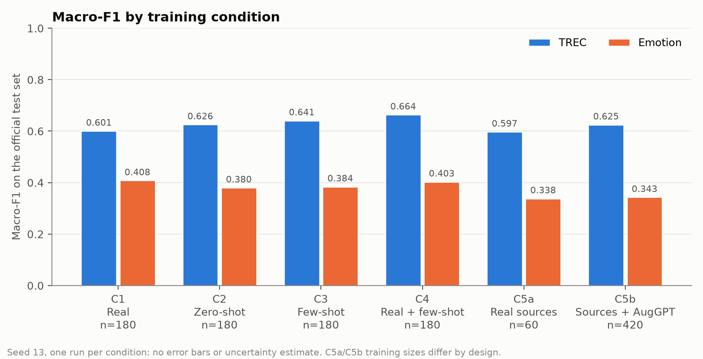
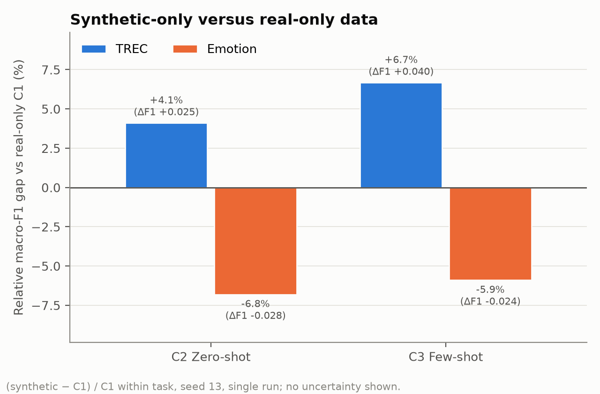

# Synthetic Training Data from a Compact Local LLM on an Objective and a Subjective Text-Classification Task: An Exploratory Single-Seed Comparison (scope30-v1)

**Workstream authors:** Harshita (@harshitadjainbdes24-byte), data generation; Kausthuba Belagod (@kausthubabelagodbdes24-oss), training and project lead; Hementh (@hem4456), evaluation and report assembly<br>
**Project:** SynthText, AI & ML minor project. Repository: `kausthubabelagodbdes24-oss/LLM-synthetic-data-classifiers`<br>
**Report date:** 1 November 2026. **Status:** assembled for lead review (issue #17). The project lead has not yet reviewed or accepted this report or its PDF.

*Contributions and execution provenance.* Accountable workstream ownership follows [ADR 0015](adr/0015-restore-original-workstream-ownership.md): Harshita owns data generation and Sections 2, 3a, 6 and Appendix A; Kausthuba owns data preparation, training, Sections 3b and 4, and project leadership; Hementh owns evaluation, analysis, Sections 1 and 5, and report assembly. During the compressed execution window, Kausthuba implemented and integrated some generation and evaluation tasks on their behalf. This records the actual implementing account without transferring their workstream authorship or ownership.

*Evidence base.* Every number in this report comes from committed, accepted artifacts: the freeze manifest `docs/freeze/scope30-v1-seed13.freeze.json` (#12), the accepted twelve-key grid as bound by `docs/analysis/scope30-v1-seed13/analysis.json` (#13, #14), the issue #11 review evidence and the accepted report modules in `docs/report/` (#15, #16). `python -m ws3_evaluation.report_scope30 --check` re-checks those values.

**Abstract.** We trained frozen-embedding logistic-regression classifiers on real, LLM-generated and mixed training sets for two six-class tasks: TREC question type (treated as the objective task) and Emotion (treated as the subjective task). The six conditions are real data (C1), zero-shot synthetic (C2), few-shot synthetic (C3), a half-real, half-few-shot mix (C4), ten real sources per label (C5a), and those sources plus six AugGPT paraphrases each (C5b). Synthetic text came from a local `qwen3:4b` model. C1–C4 use 180 training rows per task; C5a uses 60 and C5b uses 420. With one seed (13) and one run per condition, both synthetic-only conditions scored above real data on TREC (relative macro-F1 gaps +4.12% and +6.69%) and below it on Emotion (−6.80% and −5.90%). This direction matches the planned expectation of a larger negative gap on the more subjective task. However, a single run cannot estimate reliability, the two tasks differ in more than subjectivity, and synthetic-data quality was screened only by model-assisted and heuristic review. The results are therefore exploratory observations. Statistical significance was not assessed or claimed, and no stability or causal claim is made.

## 1. Introduction

Labelled training data is slow and expensive to collect, and large language models (LLMs) can produce labelled text cheaply. Li et al. (2023) reported that the subjectivity of a classification task is negatively associated with the performance of models trained on LLM-generated data. This project asks a narrow version of that question with a compact local generator. Does a classifier trained only on synthetic text fall further behind real-data training on a subjective task than on an objective one? We also ask three secondary questions: whether few-shot prompting differs from zero-shot prompting, whether mixing synthetic with real data differs from real data alone, and whether AugGPT paraphrases added to a small real sample differ from that sample alone.

The executed design is scope30-v1 ([ADR 0012](adr/0012-eod-exploratory-30-seed13.md)): two tasks, six conditions and seed 13 only, giving twelve task/condition result keys evaluated on the untouched official test sets. It is an exploratory comparison. It is not a causal test of subjectivity, an equal-labelling-budget experiment or a replicated study. The results may contradict the hypothesis, and on TREC they do.

## 2. Related Work

**Synthetic data and task subjectivity.** Li et al. (2023) generated training data with an LLM for a range of text-classification tasks. They found that subjectivity, at both the task level and the instance level, is negatively associated with the performance of models trained on the synthetic data. Our task pairing (TREC versus Emotion) and planned expectation follow this work. Our study, however, does not measure subjectivity. It only compares two tasks that differ in it, among other things.

**AugGPT.** Dai et al. (2023) proposed AugGPT, which uses ChatGPT to rephrase each training sentence into several variants that keep the concept but vary the wording. The augmented samples are used to train downstream few-shot text classifiers. C5b applies the same idea with a local model: six paraphrases of each of the ten real sources per label.

**Few-shot in-context learning.** Brown et al. (2020) showed that a large language model can perform a task from a handful of demonstrations in its prompt, without gradient updates. C3 conditions generation on three real same-label demonstrations drawn from a reserved pool. C2 uses label definitions only.

**Sentence embeddings.** Reimers and Gurevych (2019) introduced Sentence-BERT, which fine-tunes BERT-style encoders in siamese and triplet networks to produce sentence embeddings that can be compared directly. All of our classifiers use frozen embeddings from the `sentence-transformers/all-MiniLM-L6-v2` checkpoint. Only the training data differs between conditions.

## 3. Tasks, Data and Generation

### 3.1 Tasks and real data

| | TREC (objective) | Emotion (subjective) |
|---|---|---|
| Source | `SetFit/TREC-QC` | `dair-ai/emotion` (split configuration) |
| Labels | abbreviation, description, entity, human, location, numeric | sadness, joy, love, anger, fear, surprise |
| Official train → `train` / `pool` | 5,452 → 4,907 / 545 | 16,000 → 14,400 / 1,600 |
| Official test (untouched) | 500 | 2,000 |
| `lowres_seed13` sources | 60 (10 per label, from `pool`) | 60 (10 per label, from `pool`) |

`ws2_training/prepare_data.py` split each official training set 90/10 into disjoint `train` and `pool` files with a fixed seed-0 shuffle. `train` supplies C1 and the real half of C4. `pool` supplies the few-shot demonstrations and the canonical ten-per-label low-resource sample `lowres_seed13` used by C5a/C5b. The official test sets are used only for evaluation, and the Emotion validation split is not used. In Emotion, annoyance belongs under anger and anxiety under fear. Every file is canonical UTF-8 JSONL with LF line endings, and its SHA-256 is pinned in `prepare_data.CHECKSUMS` (Appendix A.4).

### 3.2 Generator and prompts

All synthetic text was produced offline through Ollama by `qwen3:4b` (digest `359d7dd4…`, pinned in `APPROVED_GENERATORS`) at temperature 0.9. This model replaced `llama3.2:3b` after that model's pilot showed label drift ([ADR 0010](adr/0010-test-qwen-fallback-after-pilot-failure.md), [ADR 0011](adr/0011-accept-qwen-pilot-and-uniform-100-target.md)). The pilot report records Ollama 0.40.13 on an NVIDIA RTX 4060 Laptop GPU (8 GiB). Every call requests a JSON reply (`{"examples": [...]}`). There are three prompt families; the exact templates are in Appendix A.1.

- **Zero-shot (C2).** Task context, the target label and its definition, label-specific boundary rules that separate easily confused classes, a word limit (TREC 20, Emotion 30) and a rotating diversity nudge. Default model thinking is retained.
- **Few-shot (C3, and the synthetic half of C4).** The zero-shot prompt plus three real same-label demonstrations from `pool`, with an instruction to write new examples and not copy or paraphrase the demonstrations.
- **AugGPT (C5b).** Six rephrasings of one exact `lowres_seed13` source.
  - Emotion sources longer than 30 words also receive a length guard (`auggpt-length-guard-v1`).
  - Every TREC source receives the corrected answer-type prompt (`auggpt-trec-answer-type-v2`, [ADR 0013](adr/0013-trec-auggpt-answer-type.md)). It supplies the source's label and definition and requires the same expected answer type, facts, participants, negation and intent. Its calls send `"think": false` and `num_predict: 1024`.

**Admission rules.** A model call is retried up to three times. Before a candidate is counted, the generator rejects:

- unparseable, empty, one-word or over-length replies, and assistant chatter;
- normalized duplicates within the artifact (normalization is lower-casing plus whitespace collapsing);
- exact normalized matches to held-out test text;
- copies of the prompt's demonstrations (few-shot) or of a low-resource source (AugGPT).

Each accepted batch passes through an identity-bound write-ahead journal and an append-only provenance sidecar. Sidecars record the model digest, the generation fingerprint, prompt and source hashes and the session history.

### 3.3 Selection, counts and labelling costs

Zero- and few-shot generation produced some excess rows. Exactly 30 rows per label were selected by the ADR 0012 rule: within each label, take the first 30 by ascending SHA-256 of UTF-8 `scope30-v1|13|<task>|<setting>|<row-id>`, with the row ID as tie-breaker. The rule never reads text or test performance. Originals are preserved, and deterministic selection manifests record the selected IDs and hashes. AugGPT has no selection step: each of the 60 exact sources has exactly six distinct valid paraphrases.

- Four selected zero/few-shot artifacts hold 180 rows each, 720 texts in total.
- Two AugGPT artifacts hold 360 paraphrases each, 720 in total.
- The study therefore uses **1,440** generated texts.

The selected few-shot corpora drew on **59** distinct real demonstrations for TREC and **54** for Emotion. These are real labelled examples consumed in addition to the classifier training counts. Separately, 18 normalized TREC texts occur in both the selected zero-shot and few-shot corpora; Emotion has none.

### 3.4 Quality screening and freeze

Content quality was screened by **model-assisted** review.

- **Reviewer.** Claude Opus 5.5 (`claude-opus-5-5`; exact snapshot unavailable), run in a Claude Code session operated by the author, giving one judgment per item. The same model family wrote the tooling and drew the samples.
- **Sample.** Ten rows per task × setting (six batches, 60 reviews), drawn reproducibly by the `issue11-quality-v1` ID-hash rule. Each row was judged for label fit, naturalness, style, copying and (for AugGPT) preservation of the source meaning.
- **Trigger.** Two or more clear errors (wrong label or changed source meaning) in a batch's ten flag it for correction and a fresh round.

| Batch | Latest random round | Clear errors / 10 | Ambiguous | Outcome |
|---|---|---:|---:|---|
| trec/zero_shot | 1 | 0 | 0 | PASS |
| trec/few_shot | 1 | 0 | 0 | PASS |
| trec/auggpt (v2, promoted) | 2 | 1 | 3 | PASS |
| emotion/zero_shot | 1 | 0 | 0 | PASS |
| emotion/few_shot | 1 | 0 | 1 | PASS |
| emotion/auggpt | 1 | 0 | 6 | PASS |

**TREC AugGPT correction.** In round 1, TREC AugGPT was flagged with two answer-type changes. It was regenerated under the corrected prompt as an isolated candidate. The candidate was promoted with the original preserved (`4711ebe6…`). A fresh round 2 of ten new rows found one clear error (`04163.aug4`, "Hot Wheels" became "Hot and Wheels").

**Checks outside the random denominator.**

- A targeted re-check of the ten round-1 IDs resolved `04257.aug5`, but `00845.aug3` still changes the answer type.
- A supplementary Emotion check, later re-adjudicated, found that all 12 paraphrases of two long sources (`07790`, `15223`) change the source meaning.
- A heuristic scan of all 360 TREC paraphrases found about 13 likely problematic and 6 borderline rows, of which about 3–4 may change the intended label.

The lead accepted the corpora under **Option A** of issue #12: frozen without relabelling, deletion or further regeneration, with these defects disclosed. The freeze manifest (SHA-256 `dd2e52ee…`) binds every consumed file, ordered ID list, sidecar, prompt identity and all 16 review files. Training reads only those frozen files.

These counts come from small samples, one model and heuristics. They are **not** independent human review, inter-annotator agreement or population error rates, and the retained errors are not claimed to be harmless.

## 4. Classifier and Experimental Conditions

**Representation and classifier.**

- **Embedder.** Every text is embedded by frozen `sentence-transformers/all-MiniLM-L6-v2` (384 dimensions), pinned to revision `1110a243fdf4706b3f48f1d95db1a4f5529b4d41`, with snapshot identity SHA-256 `36bb9511…` over the recorded file hashes. Embeddings are L2-normalized and computed on CPU with batch size 64 and no fine-tuning.
- **Classifier.** scikit-learn `LogisticRegression(C=1.0, max_iter=2000, random_state=13)`, fitted after a `random.Random(13)` shuffle of the training rows. These are the only classifier settings recorded in the grid binding; the remaining arguments are library defaults.

**Conditions.** The grid is two tasks × six conditions × seed 13, giving **twelve result keys**.

| Condition | Training set per task | n_train | Real training rows | Synthetic rows | Real demonstrations behind synthetic rows (TREC / Emotion) |
|---|---|---:|---:|---:|---|
| C1 | 30 real per label, seed-13 sample of `train` | 180 | 180 | 0 | 0 / 0 |
| C2 | 30 selected zero-shot per label | 180 | 0 | 180 | 0 / 0 |
| C3 | 30 selected few-shot per label | 180 | 0 | 180 | 59 / 54 |
| C4 | 15 real + 15 few-shot per label | 180 | 90 | 90 | at most 59 / 54 |
| C5a | 10 `lowres_seed13` sources per label | 60 | 60 | 0 | 0 / 0 |
| C5b | C5a sources + 6 AugGPT paraphrases each | 420 | 60 | 360 | 0 / 0 |

**Deterministic, frozen inputs.** `ws2_training/train_scope30.py` builds each training set as follows.

- **C1:** `per_label_sample(train, 30, seed 13, exact)`.
- **C4, real half:** an independent seed-13 `per_label_sample(train, 15, …)`.
- **C4, synthetic half:** the first 15 per label of the C3 corpus in the same ADR 0012 rank order.

The trainer refuses to build any set or fit any classifier until the freeze verifies. It rejects wrong counts, missing labels, duplicate IDs or texts, pool rows in the C1/C4 real samples, and any test-ID or test-text overlap. It writes one self-hashed record per key to a fresh results directory. The grid was run once at commit `1354118b…`. Its completion record `grid_complete.json` (SHA-256 `3b12bbb8…`) pins all twelve records, and the lead accepted it on issue #13 on 1 November 2026.

**Disclosed TREC duplicate.** The seed-13 TREC sample includes `trec.train.05262` ("What is the abbreviation for Texas ?"). Its normalized text equals test item `trec.test.00378` (abbreviation). Under the lead's "Pin + disclose" decision on #13, this single duplicate is allowed only in TREC C1 and C4. It is recorded in those results, and every other overlap fails closed.

**Metrics.** We report macro-F1 (primary) and accuracy on the official test sets. For C2 and C3, the relative gap is (synthetic macro-F1 − same-task C1 macro-F1) / C1 macro-F1, reported with the absolute difference. A C1 of zero would make the relative gap undefined, and a missing C1 would block the analysis; neither occurred. Equal training sizes in C1–C4 do not mean equal labelling cost (see the demonstrations column). C5a and C5b differ in size by design.

## 5. Results

Table 1 lists the twelve accepted results and Table 2 the four planned comparisons. All values are single runs at seed 13 and are shown to four decimals from the full-precision `analysis.json`. No standard deviation, confidence interval or significance test was computed for the single run, and none is shown.

**Table 1. Macro-F1 and accuracy of the twelve accepted results on the official test sets.**

| Task | Condition | n_train | Macro-F1 | Accuracy |
|---|---|---:|---:|---:|
| TREC | C1 Real | 180 | 0.6009 | 0.6520 |
| TREC | C2 Zero-shot | 180 | 0.6257 | 0.6680 |
| TREC | C3 Few-shot | 180 | 0.6411 | 0.6880 |
| TREC | C4 Real + few-shot | 180 | 0.6638 | 0.7100 |
| TREC | C5a Real sources | 60 | 0.5974 | 0.6400 |
| TREC | C5b Sources + AugGPT | 420 | 0.6251 | 0.6700 |
| Emotion | C1 Real | 180 | 0.4082 | 0.4420 |
| Emotion | C2 Zero-shot | 180 | 0.3804 | 0.4305 |
| Emotion | C3 Few-shot | 180 | 0.3841 | 0.4285 |
| Emotion | C4 Real + few-shot | 180 | 0.4033 | 0.4425 |
| Emotion | C5a Real sources | 60 | 0.3381 | 0.3730 |
| Emotion | C5b Sources + AugGPT | 420 | 0.3432 | 0.3705 |



**Figure 1** (`f1_by_condition.png`, unchanged from #14) shows Table 1's macro-F1 values. TREC scores lie between 0.5974 and 0.6638 and Emotion scores between 0.3381 and 0.4082.



**Figure 2** (`gap.png`, unchanged from #14) shows the C2/C3 relative gaps. Both are defined, because neither C1 is zero.

**Table 2. The four planned comparisons (within-task differences, A − B).** For C2/C3 versus C1, the relative gap is also shown. "Test items" converts the accuracy difference into test examples (TREC 500, Emotion 2,000).

| Comparison | Task | Macro-F1 A − B | Relative gap | Accuracy A − B | Test items |
|---|---|---:|---:|---:|---:|
| 1. C2 − C1 (zero-shot vs real) | TREC | +0.0247 | +4.12% | +0.0160 | +8 |
| | Emotion | −0.0278 | −6.80% | −0.0115 | −23 |
| 1. C3 − C1 (few-shot vs real) | TREC | +0.0402 | +6.69% | +0.0360 | +18 |
| | Emotion | −0.0241 | −5.90% | −0.0135 | −27 |
| 2. C3 − C2 (few-shot vs zero-shot) | TREC | +0.0155 | | +0.0200 | +10 |
| | Emotion | +0.0037 | | −0.0020 | −4 |
| 3. C4 − C1 (mix vs real) | TREC | +0.0629 | | +0.0580 | +29 |
| | Emotion | −0.0049 | | +0.0005 | +1 |
| 4. C5b − C5a (AugGPT, 420 vs 60 rows) | TREC | +0.0277 | | +0.0300 | +15 |
| | Emotion | +0.0051 | | −0.0025 | −5 |

**Comparison 1: synthetic-only versus real, across tasks.** On TREC, both synthetic-only sets scored above C1. On Emotion, both scored below it. Emotion minus TREC is −10.92 percentage points of relative gap for C2 (−0.0525 absolute macro-F1) and −12.59 points for C3 (−0.0643). This is the direction the plan expected (a larger negative gap on the more subjective task). TREC synthetic data scoring above real data is a single-sample observation. Possible explanations, such as more prototypical generated questions, the particular 180-row real sample, or the nine-item abbreviation test class (as recorded in the #14 interpretation), were not tested.

**Comparison 2: few-shot versus zero-shot.** On TREC, C3 was higher than C2 on both metrics. On Emotion, C3 was higher on macro-F1 and lower on accuracy, a difference of four test texts. Few-shot generation used 59 (TREC) and 54 (Emotion) real demonstrations that zero-shot did not.

**Comparison 3: mix versus real.** On TREC, C4 scored higher than C1 on both metrics. This is the largest absolute macro-F1 difference among the four planned comparisons (Table 2), although only 90 of C4's 180 rows are real. On Emotion, C4 was lower on macro-F1 and higher on accuracy (one test text).

**Comparison 4: AugGPT versus sources.** On TREC, C5b scored higher than C5a on both metrics. On Emotion, C5b was higher on macro-F1 and lower on accuracy. C5b has seven times as many training rows as C5a from the same 60 real sources, so the difference mixes paraphrase content with training-set size. The retained AugGPT defects (Section 3.4) are part of that content.

**Summary of directions.** On TREC, C2, C3 and C4 scored above C1, and C5b above C5a, on both metrics. On Emotion, C2 and C3 scored below C1 on both metrics, while C4 − C1 and C5b − C5a have opposite signs on the two metrics. Every Emotion difference is at most 0.0278 macro-F1 in absolute value. No equivalence or meaningfulness threshold was defined in advance, so no difference is described as a gain, a loss, equivalence or no change, and the reliability of every direction is unknown.

## 6. Limitations and Conclusions

**Limitations.**

1. **One seed, one run.** All twelve values come from seed 13. A different seed (a different real sample, generated corpus or selection) could change any difference, including its sign. Statistical significance was not assessed or claimed, and no confidence interval, stability or replication claim is made.
2. **Small data.** C1–C4 use 30 examples per label and C5a uses 10. TREC's abbreviation test class is small (nine items, per the #14 interpretation), so a few test items can move its macro-F1.
3. **Task confounding.** TREC and Emotion also differ in label semantics, text length and style, test-set size (500 versus 2,000), label balance and baseline level. The cross-task difference therefore cannot be attributed to subjectivity, and this study does not claim that subjectivity caused it.
4. **Unequal C5 sizes and unequal labelling costs.** C5a has 60 rows and C5b 420. C3 drew on 59 (TREC) and 54 (Emotion) real demonstrations beyond its training count, and C4 on at most 59 / 54: the exact number behind C4's 90 few-shot rows cannot be computed from committed artifacts. C5b reuses the C5a sources.
5. **Model-assisted and heuristic quality review.** One model judged ten items per batch, plus targeted checks and regex scans. This is not independent human annotation or inter-annotator agreement, and its counts are not population error rates. Known defects were retained under Option A: about 13 problematic TREC AugGPT paraphrases, `00845.aug3`, and all 12 paraphrases of two Emotion sources.
6. **Other disclosed artifacts.** One official TREC train/test duplicate is in C1 and C4, and 18 TREC texts are shared between the C2 and C3 corpora.
7. **Fixed pipeline.** The study uses one compact generator (`qwen3:4b`), frozen MiniLM embeddings and logistic regression. Results may not transfer to other generators, embeddings or classifiers.

**Conclusions.** In this exploratory scope30-v1 run, synthetic-only training data from `qwen3:4b` scored above 180 real examples on TREC and below them on Emotion. The relative gap was 10.92 (zero-shot) and 12.59 (few-shot) percentage points more negative on Emotion. This direction is consistent with the expectation drawn from Li et al. (2023). The other comparisons showed same-sign directions on TREC and mixed metric directions on Emotion. With one seed, the reliability of these observations is unknown. Statistical significance was not assessed or claimed, and the observations do not establish stability, generalisation or a causal role for subjectivity. This study did not include additional seeds, a predefined equivalence threshold or controls for the non-subjective differences between the tasks; those are natural next steps.

## References

Brown, T. B., Mann, B., Ryder, N., Subbiah, M., Kaplan, J., Dhariwal, P., Neelakantan, A., Shyam, P., Sastry, G., Askell, A., Agarwal, S., Herbert-Voss, A., Krueger, G., Henighan, T., Child, R., Ramesh, A., Ziegler, D. M., Wu, J., Winter, C., Hesse, C., Chen, M., Sigler, E., Litwin, M., Gray, S., Chess, B., Clark, J., Berner, C., McCandlish, S., Radford, A., Sutskever, I., and Amodei, D. (2020). Language Models are Few-Shot Learners. In *Advances in Neural Information Processing Systems 33 (NeurIPS 2020)*, pages 1877–1901. arXiv:2005.14165.

Dai, H., Liu, Z., Liao, W., Huang, X., Cao, Y., Wu, Z., Zhao, L., Xu, S., Liu, W., Liu, N., Li, S., Zhu, D., Cai, H., Sun, L., Li, Q., Shen, D., Liu, T., and Li, X. (2023). AugGPT: Leveraging ChatGPT for Text Data Augmentation. arXiv preprint arXiv:2302.13007.

Li, Z., Zhu, H., Lu, Z., and Yin, M. (2023). Synthetic Data Generation with Large Language Models for Text Classification: Potential and Limitations. In *Proceedings of the 2023 Conference on Empirical Methods in Natural Language Processing (EMNLP 2023)*, pages 10443–10461, Singapore. Association for Computational Linguistics. doi:10.18653/v1/2023.emnlp-main.647.

Reimers, N. and Gurevych, I. (2019). Sentence-BERT: Sentence Embeddings using Siamese BERT-Networks. In *Proceedings of the 2019 Conference on Empirical Methods in Natural Language Processing and the 9th International Joint Conference on Natural Language Processing (EMNLP-IJCNLP 2019)*, pages 3982–3992, Hong Kong, China. Association for Computational Linguistics. doi:10.18653/v1/D19-1410.

Datasets: `SetFit/TREC-QC` and `dair-ai/emotion` (split configuration), obtained through Hugging Face `datasets`. Embedding checkpoint: `sentence-transformers/all-MiniLM-L6-v2`, revision `1110a243fdf4706b3f48f1d95db1a4f5529b4d41`.

<div class="appendix-break"></div>

## Appendix A. Prompt Templates, Generation Examples and Provenance

*Appendix A is supplementary material. It is separate from the main report (Sections 1–6 and References) and is not counted toward the 6–8 page working target. Corpus text appears here only for the selected examples below. These are quoted from the accepted issue #15 appendix, whose prompt-template parity and row provenance are tested by `tests/test_generation_report_sections.py`.*

### A.1 Prompt templates (verbatim from `ws1_generation/generate.py`)

The exact prompt generation functions from `ws1_generation/generate.py` are documented below. All prompts enforce valid JSON replies formatted as `{"examples": ["...", "..."]}`.

#### 1. Zero-Shot Prompt Template (`prompt_zero_shot`)

```python
NUDGES = [
    "Pick specific, uncommon subjects.",
    "Mix short and longer examples.",
    "Use a different sentence structure each time.",
    "Avoid repeating the same opening words."
]

def prompt_zero_shot(task, label, n, i):
    t = CFG["tasks"][task]
    if task == "trec":
        boundaries = {
            "abbreviation": "Ask explicitly for an acronym's expansion or a shortened form. "
                            "Do not ask for a general definition or explanation.",
            "entity": "The answer must name a non-human thing, object, product, animal or substance. "
                      "Do not ask for a definition, acronym expansion or chemical symbol.",
            "description": "Ask for an explanation, definition, reason or how something works. "
                           "Do not ask what an acronym stands for.",
            "human": "The answer must name a person, team, group or organisation. "
                     "Mentioning a person does not suffice when the requested answer is their work or creation.",
            "location": "The answer must be a geographic place such as a city, country, mountain or river. "
                        "Do not ask for a person, definition, count, age or acronym expansion.",
            "numeric": "The answer must be a number, count, date, age, duration or measurement. "
                       "Do not ask for a product name or a place name.",
        }[label] + " Ask open questions, not yes/no questions."
    else:
        boundaries = {
            "sadness": "Clearly express feeling sad, lonely, hurt or low in a concrete situation.",
            "joy": "Clearly express happiness, delight, contentment or excitement. "
                   "The dominant feeling should be happiness rather than affection toward someone.",
            "love": "Clearly express affection, tenderness or care toward someone or something. "
                    "A good event or feeling happy alone is not sufficient.",
            "anger": "Clearly express anger, irritation, frustration or annoyance about a situation. "
                     "Do not rely on a situation alone without expressing the writer's reaction.",
            "fear": "Clearly express feeling afraid, anxious, nervous or worried about a threat or uncertainty.",
            "surprise": "Clearly express being amazed, shocked or caught off guard by an unexpected event. "
                        "Mentioning a surprise party alone does not establish the writer's reaction.",
        }[label] + " Make this the clear dominant emotion; use varied situations and natural wording."
    return (f"You are building a dataset of {t['context']}.\n"
            f"Write {n} different examples of {t['style']}.\n"
            f'Every example must have the label "{label}", meaning: {t["labels"][label]}.\n'
            f"Requirements for this label: {boundaries}\n"
            f"At most {t['max_words']} words each. {NUDGES[i % len(NUDGES)]}\n"
            "Check each candidate against the requested label before returning it. "
            "Return only examples that clearly fit; do not include answers or explanations.\n"
            'Reply only with JSON: {"examples": ["...", "..."]}')
```

#### 2. Few-Shot Prompt Template (`prompt_few_shot`)

The few-shot prompt inherits the zero-shot task framing, label definition, and boundaries, inserting three real demonstrations from the isolated demonstration pool split:

```python
def prompt_few_shot(task, label, n, examples, i):
    shown = "\n".join(f"- {json.dumps(e)}" for e in examples)
    return (prompt_zero_shot(task, label, n, i).replace(
        "Reply only", f"Here are real examples with this label:\n{shown}\n"
        "Use these for style, while following the requested label's requirements above.\n"
        "Write NEW examples in the same style. Do not copy or paraphrase these.\nReply only"))
```

#### 3. AugGPT Paraphrasing Templates

The AugGPT pipeline utilizes three prompt variants depending on task and source length:

**Base AugGPT Template (`prompt_auggpt`):**
```python
def prompt_auggpt(text, k):
    return (f"Please rephrase the following sentence {k} different ways, keeping its meaning:\n"
            f"{json.dumps(text)}\n"
            'Reply only with JSON: {"examples": ["...", "..."]}')
```

**Length Guard Variant (`prompt_auggpt_length_guard`):**
Used when source length exceeds `max_words` (30 words in Emotion):
```python
def prompt_auggpt_length_guard(text, k, max_words):
    return prompt_auggpt(text, k).replace(
        "Reply only",
        f"Each rephrasing must be at most {max_words} words, so shorten it: keep the main "
        "meaning and the writer's feeling, and leave out minor details.\nReply only")
```

**Corrected TREC Answer-Type Template (`prompt_auggpt_trec_answer_type`, ADR 0013 v2):**
Replaces the base prompt for all TREC seed-13 AugGPT sources. Calls send `{"think": false, "num_predict": 1024}`:
```python
def prompt_auggpt_trec_answer_type(text, k, label, definition, max_words):
    label_rule = {
        "abbreviation": "If it asks what an abbreviation or acronym stands for, every rephrasing must still "
                        "ask what it stands for (its expansion), not for a definition, meaning or explanation "
                        "of the thing. If it asks for the abbreviation of something, every rephrasing must "
                        "still ask for that abbreviation.",
        "description": "Every rephrasing must remain a question asking for an explanation, definition, "
                       "reason or how something is done, never one whose answer is a name, person, place, "
                       "number or event.",
        "human": "If it asks who a named person, group or organisation is (for example \"Who is X ?\"), "
                 "every rephrasing must still ask who that same person, group or organisation is; it keeps "
                 "the human label, so do not turn it into a request for a definition, explanation or "
                 "biography. Otherwise every rephrasing must still expect a person, group of people, "
                 "organisation or title as its answer.",
    }.get(label, f"Every rephrasing must still expect this kind of answer: {definition}.")
    return (f"Please rephrase the following question {k} different ways:\n"
            f"{json.dumps(text)}\n"
            f'Its answer-type label is "{label}", meaning: {definition}.\n'
            "Every rephrasing must keep the same expected answer type, so it keeps this label. "
            f"{label_rule}\n"
            "Keep the same facts and relationships between them, the same entities and participants "
            "(who did what to whom), any negation, and the same intent.\n"
            "Each rephrasing must be a question or request for information. Do not answer the question, "
            "and do not add facts, names, dates or details that are not in it.\n"
            f"Each rephrasing must be at most {max_words} words; if the question is longer, word it more "
            "concisely without dropping any of its facts.\n"
            'Reply only with JSON: {"examples": ["...", "..."]}')
```


### A.2 Good and problematic examples from the frozen scope30-v1 artifacts

Below are two good and two problematic examples per task selected directly from the accepted final artifacts reviewed in Issue #11 and frozen under Issue #12 ([`docs/freeze/scope30-v1-seed13.freeze.json`](freeze/scope30-v1-seed13.freeze.json)). Every item is identified by its artifact hash, generation fingerprint, row ID, source ID (where applicable), label, and model-assisted review assessment.

#### Objective Task: TREC Question Classification

##### 1. Good Example (Abbreviation Expansion Preserved)

- **Item ID:** `trec.train.04455.seed13.aug6`
- **Artifact:** `data/synthetic/trec/auggpt_seed13.jsonl` (ADR 0013 v2 promoted; SHA-256 `cf526bb948ef0e5227d54434ec897429bb0afe3f7a803579d34b374c5755ef07`)
- **Generation Fingerprint:** `c4d5308aa37a6ca8c8a820fc14e042376101bb2cddf352f25c5b933c2e3a4f56`
- **Source ID:** `trec.train.04455` (from `trec/lowres_seed13.jsonl`, SHA-256 `901c0596…`)
- **Source Text:** `What does `` B.Y.O.B. '' mean ?`
- **Intended Label:** `abbreviation`
- **Generated Text:** `"What is B.Y.O.B. expanded to?"`
- **Review Provenance:** Round 2 random audit (`docs/reviews/issue11/round2_judgments.json`, order 5).
- **Rubric Judgment:** `label_fit: fits`, `naturalness: natural`, `style_fit: natural`, `clear_error: false`, `ambiguous: false`. Successfully complies with ADR 0013 by requesting the acronym's expansion rather than drifting into a general definition request.

##### 2. Good Example (Geographic Location Question Preserved)

- **Item ID:** `trec.train.03037.seed13.aug3`
- **Artifact:** `data/synthetic/trec/auggpt_seed13.jsonl` (ADR 0013 v2 promoted; SHA-256 `cf526bb9…`)
- **Generation Fingerprint:** `c4d5308aa37a6ca8c8a820fc14e042376101bb2cddf352f25c5b933c2e3a4f56`
- **Source ID:** `trec.train.03037` (from `trec/lowres_seed13.jsonl`)
- **Source Text:** `What is the largest county in size in Massachusetts ?`
- **Intended Label:** `location`
- **Generated Text:** `"Which county in Massachusetts is the largest by size?"`
- **Review Provenance:** Round 2 random audit (`docs/reviews/issue11/round2_judgments.json`, order 7).
- **Rubric Judgment:** `label_fit: fits`, `naturalness: natural`, `style_fit: natural`, `clear_error: false`, `ambiguous: false`. Rephrases concisely while cleanly retaining the geographic place answer type.

##### 3. Problematic Example (Named Entity Corruption in ADR 0013 v2)

- **Item ID:** `trec.train.04163.seed13.aug4`
- **Artifact:** `data/synthetic/trec/auggpt_seed13.jsonl` (ADR 0013 v2 promoted; SHA-256 `cf526bb9…`)
- **Generation Fingerprint:** `c4d5308aa37a6ca8c8a820fc14e042376101bb2cddf352f25c5b933c2e3a4f56`
- **Source ID:** `trec.train.04163` (from `trec/lowres_seed13.jsonl`)
- **Source Text:** `What is the history of Hot Wheels cars , and how are they produced ?`
- **Intended Label:** `description`
- **Generated Text:** `"Explain the historical background and production techniques of Hot and Wheels cars?"`
- **Review Provenance:** Round 2 random audit (`docs/reviews/issue11/round2_judgments.json`, order 4).
- **Rubric Judgment:** `label_fit: fits`, `naturalness: unnatural`, `clear_error: true`, `ambiguous: false`, `source_meaning: changed`. The named entity "Hot Wheels" is corrupted to "Hot and Wheels". Classified as a clear error in Round 2 lead review; retained under Option A.

##### 4. Problematic Example (Expected Answer-Type Drift)

- **Item ID:** `trec.train.00845.seed13.aug3`
- **Artifact:** `data/synthetic/trec/auggpt_seed13.jsonl` (ADR 0013 v2 promoted; SHA-256 `cf526bb9…`)
- **Generation Fingerprint:** `c4d5308aa37a6ca8c8a820fc14e042376101bb2cddf352f25c5b933c2e3a4f56`
- **Source ID:** `trec.train.00845` (from `trec/lowres_seed13.jsonl`)
- **Source Text:** `What is D.B. Cooper known for ?`
- **Intended Label:** `description`
- **Generated Text:** `"What specific incident does D.B. Cooper's identity refer to?"`
- **Review Provenance:** Round 2 targeted re-check (`docs/reviews/issue11/round2_recheck_judgments.json`, order 2).
- **Rubric Judgment:** `label_fit: wrong`, `clear_error: true`, `ambiguous: false`, `source_meaning: changed`. The question changes the expected answer from an explanation/description of what Cooper is known for to an `entity` answer type (a specific incident/event). Confirmed as an unresolved answer-type error outside the random denominator; retained under Option A.


#### Subjective Task: Emotion Classification

##### 1. Good Example (Natural Workplace Frustration)

- **Item ID:** `emotion.few_shot.seed13.anger.0016`
- **Artifact:** `data/synthetic/emotion/few_shot_seed13.scope30-v1.selected.jsonl` (SHA-256 `78948f67bef46675ec01ea68ec02c52527875814b7aca3b94dc381b7cf3e08ad`)
- **Generation Fingerprint:** `cec310b818092931f94e1fad8c19745e4ced1d59e21392cc6abc6a73901a73d4`
- **Demonstration IDs:** `['emotion.train.03691', 'emotion.train.08204', 'emotion.train.10029']`
- **Intended Label:** `anger`
- **Generated Text:** `"i feel angry when my boss assigns tasks i can't finish in time"`
- **Review Provenance:** Round 1 random review (`docs/reviews/issue11/round1_judgments.json`, order 50).
- **Rubric Judgment:** `label_fit: fits`, `naturalness: natural`, `style_fit: matches`, `copied_demonstration: false`, `clear_error: false`, `ambiguous: false`. Expresses direct situational frustration; no demonstration copying.

##### 2. Good Example (Expressive Accomplishment)

- **Item ID:** `emotion.zero_shot.seed13.joy.0004`
- **Artifact:** `data/synthetic/emotion/zero_shot_seed13.scope30-v1.selected.jsonl` (SHA-256 `a7458c204cc4317c0ea0d5b630174a008819107afa807546763871c8ae783285`)
- **Generation Fingerprint:** `4d2ab0f440733aa9d98b1107a776f528534d68318770d4c13652758ec17388f7`
- **Demonstration IDs:** None (zero-shot)
- **Intended Label:** `joy`
- **Generated Text:** `"i feel glad for the small achievements today that made me smile and feel accomplished"`
- **Review Provenance:** Round 1 random review (`docs/reviews/issue11/round1_judgments.json`, order 57).
- **Rubric Judgment:** `label_fit: fits`, `naturalness: natural`, `style_fit: matches`, `clear_error: false`, `ambiguous: false`. Natural emotional expression; fits canonical joy definition.

##### 3. Problematic Example (AugGPT Agent Reversal)

- **Item ID:** `emotion.train.07790.seed13.aug1`
- **Artifact:** `data/synthetic/emotion/auggpt_seed13.jsonl` (SHA-256 `59b2a6fb414c51c43ffb922b85735a81d45eafd513e95feec962eb5a8f46f67d`)
- **Generation Fingerprint:** `629fb0fd6933303afa986594b883d5c39aa358d02d505461b58a871bd46f5982` (length guard)
- **Source ID:** `emotion.train.07790` (from `emotion/lowres_seed13.jsonl`, SHA-256 `7bec4826…`)
- **Source Text:** `i usually doubt my self at this point as i feel i should be that amazing housewife who motors all day and has a list of things they can tell theyre husband they did all day while they were at work and i was at home`
- **Intended Label:** `surprise`
- **Generated Text:** `"I doubt myself now, feeling I should be the amazing housewife who works all day and has a list of what my husband did while I was home."`
- **Review Provenance:** Supplementary targeted check re-adjudication (`docs/reviews/issue11/targeted_long_sources_adjudication_2026-11-01.json`, item 1).
- **Rubric Judgment:** `clear_error: true`, `ambiguous: false`, `source_meaning: changed`. Inverts the agent: the source describes a wife making a list of what *she* did to tell her husband, whereas the paraphrase states a list of what *the husband* did while she was home. Retained under Option A.

##### 4. Problematic Example (AugGPT Subject Shift)

- **Item ID:** `emotion.train.15223.seed13.aug1`
- **Artifact:** `data/synthetic/emotion/auggpt_seed13.jsonl` (SHA-256 `59b2a6fb…`)
- **Generation Fingerprint:** `629fb0fd6933303afa986594b883d5c39aa358d02d505461b58a871bd46f5982` (length guard)
- **Source ID:** `emotion.train.15223` (from `emotion/lowres_seed13.jsonl`)
- **Source Text:** `i don t believe in my weakness he is strong i don t believe i am more than a conqueror and i feel like i m a real fake and it s not fine`
- **Intended Label:** `sadness`
- **Generated Text:** `"I don't believe I'm weak—I'm strong, but I don't think I'm more than a conqueror. I feel like a real fake, and this isn't fine."`
- **Review Provenance:** Supplementary targeted check re-adjudication (`docs/reviews/issue11/targeted_long_sources_adjudication_2026-11-01.json`, item 7).
- **Rubric Judgment:** `clear_error: true`, `ambiguous: false`, `source_meaning: changed`. The source contrasts the author's weakness against a third party's strength (*"he is strong"*), whereas the paraphrase transforms this into a self-affirmation (*"I'm strong"*), reversing propositional meaning. Retained under Option A.


### A.3 Historical pilot examples (ADR 0011; not part of the frozen corpora)

*Context note:* These eight examples were selected during the preliminary `qwen3:4b` fallback pilot review conducted by Kausthuba Belagod (single reviewer, the project operator; not an independent review) on 31 October 2026 ([ADR 0011](adr/0011-accept-qwen-pilot-and-uniform-100-target.md); [`docs/PILOT_REPORT.md`](PILOT_REPORT.md)). They represent historical screening evidence that supported adopting `qwen3:4b` over the failed Llama model, and are distinct from the final frozen `scope30-v1` artifacts above.

| Task | Setting | Row ID | Intended Label | Operator judgment | Generated Text | Historical Inspection Note |
|---|---|---|---|---|---|---|
| **trec** | `zero_shot` | `trec.zero_shot.seed13.description.0005` | `description` | **Good** | `What causes the tides?` | Clear natural description request; fits open search style. |
| **trec** | `few_shot` | `trec.few_shot.seed13.entity.0003` | `entity` | **Good** | `What is the most expensive car ever sold?` | Well-formed entity question; non-human object answer. |
| **trec** | `zero_shot` | `trec.zero_shot.seed13.entity.0005` | `entity` | **Bad** | `What is the next event?` | Underspecified premise; missing required temporal or topical context. |
| **trec** | `few_shot` | `trec.few_shot.seed13.location.0007` | `location` | **Bad** | `What river runs through London?` | Generic trivia question duplicating real-sample question frames. |
| **emotion** | `zero_shot` | `emotion.zero_shot.seed13.sadness.0002` | `sadness` | **Good** | `i feel hurt because my friend broke our promise last week` | Expresses concrete personal sadness and hurt. |
| **emotion** | `few_shot` | `emotion.few_shot.seed13.love.0009` | `love` | **Good** | `i feel my heart swell with love for the way you listen to me.` | Expresses direct interpersonal affection and tenderness. |
| **emotion** | `zero_shot` | `emotion.zero_shot.seed13.joy.0002` | `joy` | **Bad** | `i feel excited about the summer as a vacation` | Unnatural phrasing; awkward syntactic construction (*"as a vacation"*). |
| **emotion** | `few_shot` | `emotion.few_shot.seed13.fear.0005` | `fear` | **Bad** | `i feel cold sweat imagining the worst test result` | Awkward tense construction (*"feel cold sweat imagining"*). |

### A.4 Provenance identifiers

| Item | Identifier |
|---|---|
| Generator | `qwen3:4b`, digest `359d7dd4bcdab3d86b87d73ac27966f4dbb9f5efdfcc75d34a8764a09474fae7`, temperature 0.9 |
| Freeze manifest | `docs/freeze/scope30-v1-seed13.freeze.json`, SHA-256 (LF) `dd2e52ee704835525df41071ff5214c56593969d248ca8812c23b617bfd74de1` |
| Training grid | produced at `1354118b4b05bec31973c268057d8a713907f3a6`; `grid_complete.json` `3b12bbb878d8191e387e3abc0f77fc02d9f081b98f0216f9b64dbb144bf40032`; `runs.csv` `b738d780faafd66eaaa1b8ce7d87f6af7d7ac5b3f1573c3d88748c27ca5d5734` |
| Analysis | written at `c7761ec944d86e866ce1103ed2b90ecf57b3ac8c`; `analysis.json` `d0486efdceb6cec23d47fc0a943f3307a65fe9230913c38f7f50af5dc26177f6`; `f1_by_condition.png` `fc6e2f6acd9d9786d7ebb867cd232b0c757b2745e4eebf264e7a80745ba941e8`; `gap.png` `5ed188eb1a1a853a6b812fcac218ee024d7986fcdd41266ab162f50a8d4971e3` |
| Embedder | `sentence-transformers/all-MiniLM-L6-v2` revision `1110a243fdf4706b3f48f1d95db1a4f5529b4d41`, identity SHA-256 `36bb95116de1358079c1fab49ac634493101e484c99edbd882691fbf96859cad` |
| TREC `train` / `pool` / `test` / `lowres_seed13` | `b587c84d26b361bbe6f4126aff136e9d737c6c349059e89d2a3ce79e226f4331` / `0a78fbe6e38b8b9eb4f7d9e24e619d63f855e073bffb1e00edb23508490d3a6e` / `415f526277d0f23f9bfe903a2a6d994529ec183820b6d9d0d55d47c3195aa0c0` / `901c0596a42b6fd0fa128cb1dd05b26bb1dbdcbd0c1a0a3dca9011beb7a03a29` |
| Emotion `train` / `pool` / `test` / `lowres_seed13` | `4c6e92df9649661ab1c6fefe06f83206382322e6997fcb70ca53d22d302fac57` / `dde4702b5f5168f5fad977ba6b659f9304ae02a3cb37c18281e208271f847d40` / `d3b7176e8ab6be052151511a3e9843fa633c5747d0dae73980a2e52a4fb6cd88` / `7bec4826ca96fa056ec5defc13a051f1c2ac25ef0270164219af13e1471af27f` |
| Selected zero/few-shot corpora | TREC zero `de2ce33ae18b4dbc53f61e365758ef6a7e3e25d96cfcbcfc4884ac8c119fff79`, few `e803ddfe533d3b8685afabf477d22dcff7e44a6cdd3eca5e0988699bf8d48767`; Emotion zero `a7458c204cc4317c0ea0d5b630174a008819107afa807546763871c8ae783285`, few `78948f67bef46675ec01ea68ec02c52527875814b7aca3b94dc381b7cf3e08ad` |
| AugGPT artifacts | TREC (ADR 0013 v2) `cf526bb948ef0e5227d54434ec897429bb0afe3f7a803579d34b374c5755ef07`; Emotion `59b2a6fb414c51c43ffb922b85735a81d45eafd513e95feec962eb5a8f46f67d` |
| Disclosed duplicate | `trec.train.05262` = `trec.test.00378`, normalized-text SHA-256 `ba6af17c366034f8dca2abff920ba01cc773fc77eda6188a1127b8190b324d2e` |
